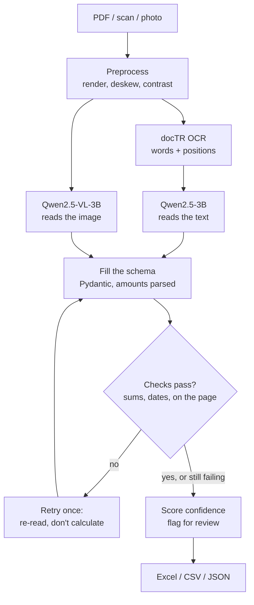

# DocExtract: AI Invoice and Receipt Extraction

**Turn scanned or photographed invoices and receipts into clean, validated Excel or JSON: vendor, invoice number, dates, line items, tax and total. Every field has a confidence score, and anything that doesn't add up is flagged for a human before it reaches the books.**


<!-- Add a screenshot or short GIF of the app here, e.g.  -->

---

## Overview

Accounting firms, logistics companies, e-commerce sellers and property managers retype thousands of invoices and receipts a month. Generic OCR returns a wall of text, not the fields a spreadsheet or ERP needs, and a chatbot can quietly invent a number.

DocExtract reads each document with a local AI model, fills a fixed schema, and then **checks its own work**: line items must add up to the subtotal, subtotal + tax must equal the total, dates must parse, and every amount must actually appear on the page. Documents that pass go straight through; the rest are flagged with the reason.

It implements **two extraction approaches and benchmarks them against each other** on public datasets, so the choice between them is backed by numbers.

## Features

- **Any input.** PDFs, scans and phone photos; pages are rendered, straightened and contrast-enhanced first.
- **Two approaches, one schema.** (A) OCR + LLM: docTR reads the text with positions, a text LLM fills the schema. (B) Vision-language model: Qwen2.5-VL reads the image directly. Compare both side by side in the UI.
- **Validation that catches real errors.** Sum checks, tax-inclusive receipts, quantity × unit price, date sanity, and a grounding check that stops the model from "fixing" a wrong total by calculating it.
- **Self-correction.** When a check fails, the model is shown what failed and asked to re-read once, without calculating.
- **Per-field confidence.** Taken from the model's token probabilities and lowered for fields involved in a failed check.
- **Robust number parsing.** `1,234.56`, `1.234,56`, `60.000` (Indonesian rupiah) and `RM 8.70` all become the right number.
- **Review-ready exports.** Excel with *Documents*, *Line items* and *Issues* sheets and doubtful cells highlighted, plus CSV and JSON.
- **Private and free to run.** Everything runs locally on a 6 GB laptop GPU, or on any OpenAI-compatible API by changing one setting.
- **Production packaging.** REST API with interactive docs, web UI, Docker Compose, unit tests and CI.

## How it works



1. **Preprocess.** PDF pages are rendered at 200 DPI; photos are straightened (Hough-line deskew) and given local contrast (CLAHE) for faded thermal receipts.
2. **Extract.** Route A rebuilds the OCR words into layout-preserving lines (an item and its price stay on one line) for the text LLM; route B sends the image to the vision model. Models copy amounts *as printed* and the code parses them.
3. **Validate.** Business rules check the arithmetic and the dates; amounts must appear in the OCR text. On failure the model gets one more try with the failed checks listed.
4. **Score.** Each field's confidence is the probability of its least certain token, halved when the field took part in a failed check. Errors or low confidence set `needs_review`.
5. **Export.** Results go to the UI, the API, or Excel / CSV / JSON files.

## Tech stack

| Layer | Technology |
| --- | --- |
| OCR | docTR (`fast_base` detector + `crnn_vgg16_bn` recogniser), PyTorch |
| Text LLM (approach A) | Qwen2.5-3B via Ollama, or any OpenAI-compatible API |
| Vision model (approach B) | Qwen2.5-VL-3B (4-bit) via Ollama, or GPT-4o-mini etc. |
| Schema and validation | Pydantic v2, python-dateutil |
| Preprocessing | PyMuPDF, OpenCV |
| Backend | FastAPI |
| Interface | Streamlit |
| Export | pandas, openpyxl |
| Evaluation | SROIE, CORD (Hugging Face), RapidFuzz |
| Deployment | Docker Compose, GitHub Actions |

## Quickstart

**Requirements:** Python 3.10 or newer, and either [Ollama](https://ollama.com) for local models or an API key for OpenAI. An NVIDIA GPU is used automatically when available.

### Windows

```powershell
.\setup.ps1     # one-time: virtual environment, PyTorch (CUDA if available), dependencies, OCR + Ollama models
.\run.ps1       # starts the API and the web app, then opens your browser
```

If script execution is restricted on your machine, run the same scripts with `powershell -ExecutionPolicy Bypass -File .\setup.ps1`.

### macOS / Linux

```bash
bash setup.sh   # one-time setup
bash run.sh     # start the app
```

### Docker

Install [Ollama](https://ollama.com) on the host and pull the models (they use the host's GPU), then start the containers:

```bash
ollama pull qwen2.5vl:3b && ollama pull qwen2.5:3b
docker compose up --build
```

The web app opens at http://localhost:8501 and the API docs at http://localhost:8000/docs. Click a sample in the sidebar to try it with a fictional invoice, including one whose total is deliberately wrong.

### Using a hosted model

Edit `.env` to point at any OpenAI-compatible provider, for example:

```ini
LLM_BASE_URL=https://api.openai.com/v1
LLM_API_KEY=sk-...
LLM_MODEL=gpt-4o-mini
VLM_MODEL=gpt-4o-mini
```

### Command line

```bash
python -m docextract invoices/ --method both --out outputs/results.xlsx
```

## Configuration

Every setting lives in [docextract/config.py](docextract/config.py) and can be overridden in `.env` (see [.env.example](.env.example)).

| Setting | Default | Meaning |
| --- | --- | --- |
| `LLM_MODEL` | `qwen2.5:3b` | Text model for approach A |
| `VLM_MODEL` | `qwen2.5vl:3b` | Vision model for approach B |
| `VLM_MAX_SIDE` | `1280` | Longest image side sent to the vision model; lower it if the GPU runs out of memory |
| `DATE_DAYFIRST` | `true` | Read `03/04/2024` as 3 April; set `false` for US invoices |
| `REVIEW_CONFIDENCE` | `0.6` | Fields below this confidence are flagged for review |
| `MAX_RETRIES` | `1` | Re-asks after a failed check |
| `DEVICE` | `auto` | `cuda` when a GPU is visible, else `cpu` (OCR only) |

## API

Interactive documentation is served at `/docs`.

| Method | Endpoint | Description |
| --- | --- | --- |
| `POST` | `/extract?method=vlm\|ocr_llm\|both` | Upload one or more files; returns the validated results |
| `POST` | `/export?format=xlsx\|csv\|json` | Turn results into a downloadable file |
| `GET` | `/health` | API and model-server status |

```bash
curl -X POST "http://localhost:8000/extract?method=vlm" -F "files=@samples/invoice_northwind.pdf"
```

## Evaluation

```bash
python scripts/download_data.py --limit 100   # SROIE + CORD test receipts, labels converted to our schema
python eval/evaluate.py --limit 100           # writes eval/results.md
```

Metrics per field: exact match (amounts as numbers, dates as dates) and ANLS (fuzzy text similarity); line-item F1 for CORD; seconds per document; and *errors caught*, the share of documents with a wrong amount that validation flagged.

Preliminary run, 10 documents per dataset, RTX 4050 laptop GPU:

| Measure | A: OCR + LLM | B: Vision model |
| --- | --- | --- |
| SROIE vendor name, exact | 40% | 100% |
| SROIE total, exact | 60% | 50% |
| CORD total, exact | 60% | 80% |
| CORD line-item F1 | 30% | 55% |
| Seconds per document | 7–15 | 13–17 |

## Project structure

```
docextract/
  config.py       settings (.env overrides)
  schema.py       Pydantic output schema + robust amount parsing
  preprocess.py   PDF/image loading, deskew, contrast
  ocr.py          docTR wrapper + layout-preserving text
  llm.py          OpenAI-compatible client, logprob -> field confidence
  extractors.py   approach A (OCR+LLM) and B (VLM)
  validate.py     normalisation and business-rule checks
  pipeline.py     extract -> validate -> retry -> score
  export.py       JSON / CSV / Excel
  api.py          REST API (FastAPI)
  cli.py          command line
app/streamlit_app.py       web UI
run.py                     starts API + UI
scripts/download_data.py   SROIE + CORD -> images + labels in our schema
scripts/make_samples.py    synthetic demo invoices in samples/
eval/evaluate.py           per-field accuracy, line-item F1, speed, errors caught
tests/                     unit tests (no GPU or model needed)
```

## Development

```bash
pip install -r requirements-dev.txt
python -m pytest        # unit tests
python -m ruff check .  # linting
```

## Design notes

- **Numbers are parsed by code, not by the model.** Models copy amounts as printed; a deterministic parser handles thousands separators and decimal commas, so a 3B model can't turn sixty thousand rupiah into 60.0.
- **The model never gets to calculate.** On retry it is told not to compute values, and every amount is checked against the OCR text, so a document that genuinely doesn't add up stays flagged instead of being silently "fixed".
- **Confidence from the model itself.** Token log-probabilities give a per-field score with no extra model calls; the least certain token decides, because one doubtful digit makes the whole amount doubtful.
- **Defensive against local-model quirks.** Ollama's schema-constrained mode garbles numeric strings and its vision runner can stall after many requests; the client uses plain JSON mode, extracts JSON from free text, and restarts the model when replies come back empty.
- **Model-agnostic.** One OpenAI-compatible client serves both approaches, so moving from local Qwen to a hosted model is a `.env` change.

## Roadmap

- [x] Schema, preprocessing, both extractors, validation with retry, confidence, export, CLI
- [x] Dataset download and evaluation harness
- [x] FastAPI service and Streamlit review UI
- [x] Docker
- [ ] Full benchmark run (100+ documents per dataset)
- [ ] Calibrate the review threshold on the benchmark data
- [ ] Stretch: fine-tune Donut / LayoutLMv3 on CORD and add it as approach C
